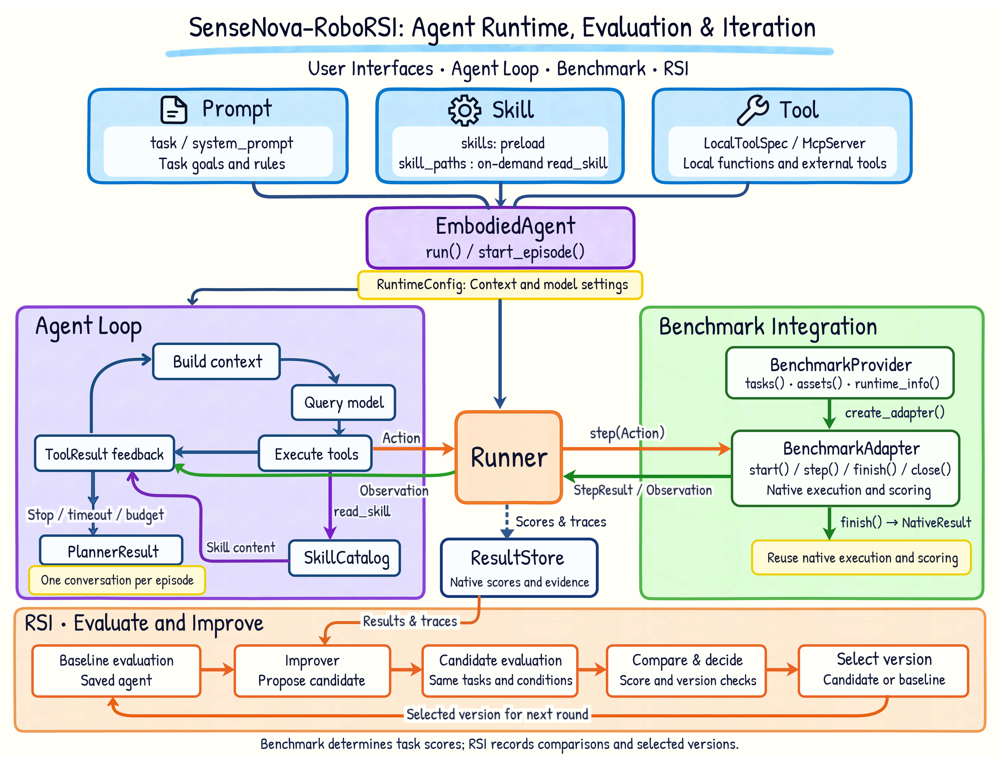
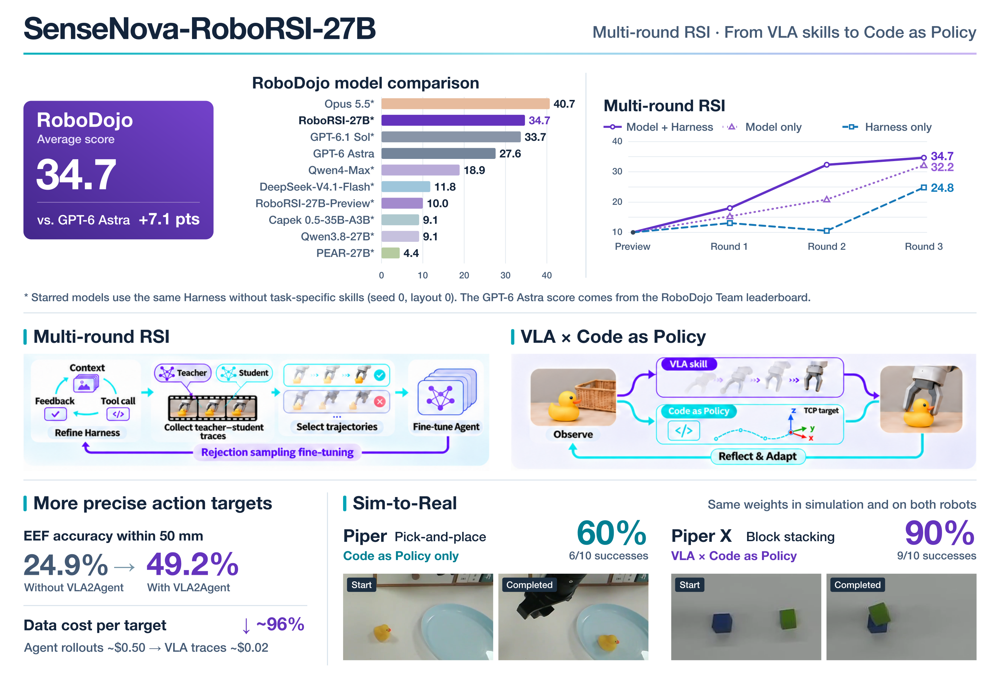
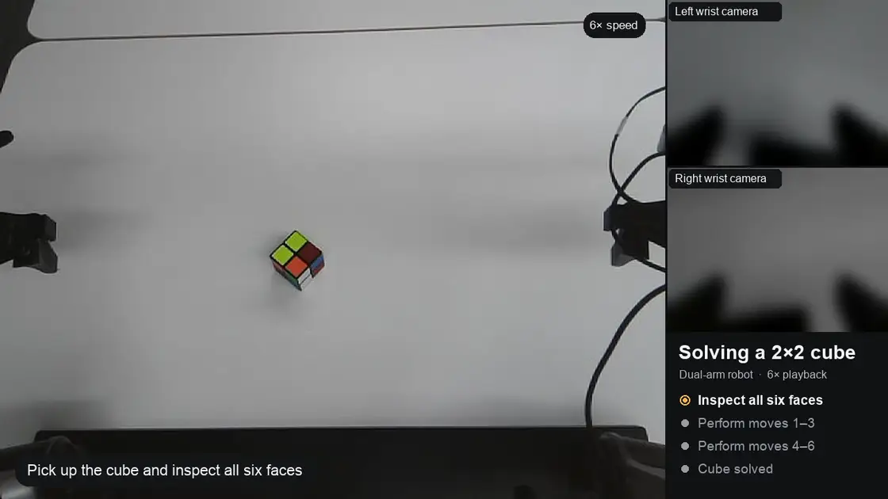

<h1 align="center">SenseNova-RoboRSI: Recursive Self-Improvement for Embodied Agents</h1>

<p align="center"><strong>Build, evaluate, and improve embodied agents with a shared runtime.</strong></p>

<p align="center">
  
  
  
</p>

<p align="center">
  <a href="https://www.sensenova.ai/has-gpt-6-astra-achieved-embodied-intelligence"></a>
  <a href="https://huggingface.co/sensenova/SenseNova-RoboRSI-27B"></a>
</p>

<p align="center">
  <strong>English</strong> · <a href="README.zh-CN.md">简体中文</a> ·
  <a href="#quick-start">Quick Start</a> ·
  <a href="https://www.sensenova.ai/has-gpt-6-astra-achieved-embodied-intelligence">Report</a> ·
  <a href="docs/sensenova-roborsi-27b.md">RoboRSI-27B</a>
</p>

## News

- **2026-11-26** — Code and usage guides for [**RoboDojo**](benchmarks/robodojo/README.md) are now available, along with [one-command reproduction scripts](docs/sensenova-roborsi-27b.md#robodojo-reproduction) for [**SenseNova-RoboRSI-27B**](https://huggingface.co/sensenova/SenseNova-RoboRSI-27B).

- **2026-11-23** — 🎉 [**SenseNova-RoboRSI-27B**](https://huggingface.co/sensenova/SenseNova-RoboRSI-27B) is now available, with an average score of **34.7** under RoboDojo’s new Agent evaluation protocol. On real robots, it succeeds in **60%** of pick-and-place trials on Piper, stacks blocks in **90%** of trials on Piper X, and uses Code as Policy to solve a 2×2 cube with both arms.

- **2026-11-19** — Initial code and usage guides for [**SIMPLE**](benchmarks/simple/README.md) are available.

- **2026-11-18** — A [collection](https://huggingface.co/datasets/sensenova/SenseNova-RoboRSI-Log) of **336 harness ablation trajectory records**, covering **42 tasks** and **8 methods**, has been released.

- **2026-11-16** — **SenseNova-RoboRSI** is now listed on the [**official RoboDojo Agent leaderboard**](https://robodojo-benchmark.com/leaderboard#agent), with an **average score of 57.10** and a **success rate of 49.17%** under **Avg. (w/o Open)**.

<details>
<summary>Earlier updates</summary>

- **2026-11-15** — Added **ICL package construction and verification tools**, plus demonstration-learning and frozen-package evaluation guides for **BEHAVIOR-1K**, **Bench2Dex** and **DexJoCo**. [ICL guide](docs/icl.md) · [Source coverage](docs/icl-coverage.md).

- **2026-11-03** — Initial code and usage guides for [**LHPR-VLN**](benchmarks/lhpr_vln/README.md) and [**VLN-CE (R2R / RxR)**](benchmarks/vlnce/README.md) are available.

- **2026-10-30** — Initial code and usage guides for [**RoboLab**](benchmarks/robolab/README.md) are available.

- **2026-10-27** — Our LIBERO-PRO result (**98.25% success rate**) is now officially ranked **No. 1** on the [Papers With Code leaderboard](https://paperswithcode.co/benchmark/libero-pro).

- **2026-10-26** — SenseNova-RoboRSI is now ranked **No. 1** on the [RoboLab leaderboard](https://research.nvidia.com/labs/srl/projects/robolab/leaderboard.html).

- **2026-10-22** — **SenseNova-RoboRSI-27B-Preview** now runs across different environments, including on real robots and in simulation! [🤗 Model weights](https://huggingface.co/sensenova/sensenova-roborsi-27b-preview) and [usage guides](docs/sensenova-roborsi-27b-preview.md) are now available. The technical report is coming soon.

- **2026-10-22** — Initial code and usage guides for [**RoboCasa365 Target50**](benchmarks/robocasa365/README.md) are available.

- **2026-10-21** — Added **benchmark images and ICL experience packages** to [BenchZoo](#benchzoo), including image references and package download links.

- **2026-10-20** — Initial code and usage guides for [**BEHAVIOR-1K**](benchmarks/behavior_1k/README.md), [**Bench2Dex**](benchmarks/bench2dex/README.md) and [**DexJoCo**](benchmarks/dexjoco/README.md) are available.

- **2026-10-16** — Initial code and usage guides for [**LIBERO**](benchmarks/libero/README.md), [**LIBERO-PRO**](benchmarks/libero_pro/README.md), [**LIBERO-Long++**](benchmarks/libero_lilo/README.md) and [**LIBERO-Ultra-Long**](benchmarks/libero_lilo/README.md) are available. See the [getting started guide](docs/getting-started.md).

- **2026-10-16** — SenseNova-RoboRSI has been used in the empirical report [**Has GPT-6 Achieved Embodied Intelligence?**](https://www.sensenova.ai/has-gpt-6-astra-achieved-embodied-intelligence).

- **2026-10-09** — SenseNova-RoboRSI achieves an **average score of 60.08** and a **success rate of 54.17%** on RoboDojo, a gain of **+31.11 points** over the GPT-6 Astra baseline (**28.97**) in our original evaluation. See [Harness Results](#harness-results) for the original comparison and the subsequently published official Agent-track results.

</details>

## Overview

Connect your model, skills, and robot tools through a shared runtime, customize
prompts and context, and evaluate policies in environments that retain their
native execution and scoring logic.

On top of this runtime, **recursive self-improvement (RSI)** uses execution
traces and task feedback to improve the agent system. During Harness optimization,
model parameters remain fixed; candidate changes are retested, and validated
improvements are carried into the next agent version.

<p align="center">
  
</p>

[SenseNova-RoboRSI-27B](docs/sensenova-roborsi-27b.md) is a vision-language model for robot manipulation, refined alongside the RoboRSI Harness over multiple rounds of RSI. It can review trajectories proposed by a VLA policy and write code to compute target poses and control the gripper. SenseNova-RoboRSI-27B learns to use VLA and Code as Policy in simulation and uses the same weights to control physical robots.



### Core capabilities

#### Harness: A shared runtime

- **Flexible agent interfaces.** Connect models, prompts, skills, and tools/MCP;
  configure context and caching to suit each task.
- **Unified execution and evaluation.** Run VLA skills, scripted actions, or
  end-effector tools across benchmarks with native feedback and scoring.
- **Experiment records and training data.** Record full traces, export training
  episodes, and run batch evaluations with concurrency and recovery.

#### SenseNova-RoboRSI-27B

- **VLA × Code as Policy.** The agent can use a VLA skill to grasp a bowl, then switch to code to correct its position before release.
- **More accurate gripper targets.** VLA2Agent turns open VLA demonstrations into training examples for the agent. With this supervision, the share of end-effector predictions within 50 mm of the target rose from 24.9% to 49.2%.
- **Sim-to-real transfer.** After simulation-only embodied post-training, the same weights handled pick-and-place on Piper using code alone and block stacking on Piper X using VLA and code.

#### RSI: Model–Harness co-evolution

- **Optimize the Harness.** Use execution feedback to refine action prediction,
  planning, feedback, and memory organization while keeping model parameters fixed
  during this stage.
- **Train from validated experience.** Collect and filter interaction traces,
  then fine-tune the embodied model to adapt to the updated Harness.
- **Retest and iterate.** Track model and Harness versions, evaluate changes
  under the same task conditions, and carry validated improvements into the next round.

## Quick Start

Use Linux/WSL, Python 3.10–3.12 and Docker; prepare GPU support where required.
From the repository root:

```bash
python -m venv .venv
source .venv/bin/activate
python -m pip install -e '.[runtime]'
```

Installation and environment prerequisites: [getting started](docs/getting-started.md).

### GPT-6 Astra: evaluate all released benchmarks

Prepare the environments and Agents once using the [suite guide](docs/gpt6-evaluation.md),
and set their paths/services in [the suite configuration](configs/evaluations/gpt6.yaml).
Then start all released benchmark cohorts with:

```bash
export OPENAI_API_KEY='YOUR_API_KEY'
python scripts/evaluation/evaluate_gpt6.py
```

The script runs each benchmark's existing Agent and reports its native scores
separately. See the guide for coverage, frozen ICL, offline plans and results.

### SenseNova-RoboRSI-27B: deployment and evaluation

Follow the [model deployment quickstart](docs/sensenova-roborsi-27b.md#quickstart) to serve the checkpoint with vLLM and test the endpoint. For an existing model endpoint, see the [deployed-model evaluation guide](docs/model-evaluation.md).

## BenchZoo

Available benchmark integrations and upcoming releases. Supported services share
configurable EmbodiedAgent presets; select your model and follow the corresponding
benchmark directory for setup and evaluation.

ICL experience packages are hosted in
[SenseNova-RoboRSI-Packages](https://huggingface.co/datasets/sensenova/SenseNova-RoboRSI-Packages).
The links below open each released benchmark's versioned package directory;
follow the package documentation for download, verification and usage.

Prebuilt images are hosted on GHCR. Use `docker pull <image>` with the
corresponding image reference from the table.

| Benchmark | Status | ICL experience package | Docker image |
| --- | --- | --- | --- |
| [RoboDojo](benchmarks/robodojo/) | Released | — | `ghcr.io/opensensenova/sensenova-roborsi-robodojo:v1.0.0-cu128-native` |
| [RoboCasa365](benchmarks/robocasa365/) | Released | [v1.0.0](https://huggingface.co/datasets/sensenova/SenseNova-RoboRSI-Packages/tree/main/robocasa365/v1.0.0) | `ghcr.io/opensensenova/sensenova-roborsi-robocasa365@sha256:28d210a42597f88c7af23b63f88fefc587edc901e268a0339cbfbf6ea1814cb5` |
| [LIBERO-Pro](benchmarks/libero_pro/) | Released | [v1.0.0](https://huggingface.co/datasets/sensenova/SenseNova-RoboRSI-Packages/tree/main/libero-pro/v1.0.0) | `ghcr.io/opensensenova/sensenova-roborsi-libero-pro@sha256:a83417f1459a4c555c457caa82ef00a5de50191e3d8deb943894fa9285cff172` |
| [LIBERO-Long++](benchmarks/libero_lilo/) | Released | [v1.0.0](https://huggingface.co/datasets/sensenova/SenseNova-RoboRSI-Packages/tree/main/libero-long-plus-plus/v1.0.0) | `ghcr.io/opensensenova/sensenova-roborsi-libero-long-plus-plus@sha256:814139261e914b114cb89a359c6a39d4f409a556f79928e986b6ade3dfe7dc7a` |
| [LIBERO-Ultra-Long](benchmarks/libero_lilo/) | Released | [v1.0.0](https://huggingface.co/datasets/sensenova/SenseNova-RoboRSI-Packages/tree/main/libero-ultra-long/v1.0.0) | `ghcr.io/opensensenova/sensenova-roborsi-libero-ultra-long@sha256:814139261e914b114cb89a359c6a39d4f409a556f79928e986b6ade3dfe7dc7a` |
| [RoboLab](benchmarks/robolab/) | Released | — | `ghcr.io/opensensenova/sensenova-roborsi-robolab@sha256:519585576bb09c5fc4a09e6255e30d74189b86b0f8c526d3fe8d99c5031da04f` |
| [Bench2Dex](benchmarks/bench2dex/) | Released | [v1.0.0](https://huggingface.co/datasets/sensenova/SenseNova-RoboRSI-Packages/tree/main/bench2dex/v1.0.0) | `ghcr.io/opensensenova/sensenova-roborsi-bench2dex@sha256:edb0701c6ea3904c53a64820775336b998e6a3d0a9ac8b3b5be2caf824db3a1b` |
| [DexJoCo](benchmarks/dexjoco/) | Released | [v1.0.0](https://huggingface.co/datasets/sensenova/SenseNova-RoboRSI-Packages/tree/main/dexjoco/v1.0.0) | `ghcr.io/opensensenova/sensenova-roborsi-dexjoco@sha256:19fa30540e3956ae460efa0a4b473586637cb330d863ea65ba0fd6318c376d4d` |
| [LHPR-VLN](benchmarks/lhpr_vln/README.md) | Released | [v1.0.0](https://huggingface.co/datasets/sensenova/SenseNova-RoboRSI-Packages/tree/495b4e2a9a3652726f52dd6363f7e2c5a77c2b34/lhvln/v1.0.0) | `ghcr.io/opensensenova/sensenova-roborsi-lhvln@sha256:7d72dd910d5c9048ca6ec40ad158214497c3a9ac276641df1429314f2d7a3695` |
| [VLN-CE (R2R / RxR)](benchmarks/vlnce/README.md) | Released | [v1.0.0](https://huggingface.co/datasets/sensenova/SenseNova-RoboRSI-Packages/tree/495b4e2a9a3652726f52dd6363f7e2c5a77c2b34/vln-ce/v1.0.0) | `ghcr.io/opensensenova/sensenova-roborsi-vln-ce@sha256:f54607562ca465101d6e1091f97d776755c2b00517f1852643bd8e0161c0e787` |
| [SIMPLE](benchmarks/simple/) | Released | [v1.0.0](https://huggingface.co/datasets/sensenova/SenseNova-RoboRSI-Packages/tree/main/simple/v1.0.0) | `ghcr.io/opensensenova/sensenova-roborsi-simple@sha256:4b6f9eb28fa87aebba7a3d46fcf0498753d81a47719dadf30a78c22d1f208213` |
| [BEHAVIOR-1K](benchmarks/behavior_1k/) | Released | [v1.0.0](https://huggingface.co/datasets/sensenova/SenseNova-RoboRSI-Packages/tree/main/behavior/v1.0.0) | `ghcr.io/opensensenova/sensenova-roborsi-behavior-1k:v1.0.0-cu128` |

## Harness Results

Each table shows SenseNova-RoboRSI alongside selected reference results. Higher is better.

### [RoboDojo](https://robodojo-benchmark.com/)

**Official Agent leaderboard:** [SenseNova-RoboRSI](https://robodojo-benchmark.com/leaderboard#agent) is listed with an **average score of 57.10** and a **success rate of 49.17%** under **Avg. (w/o Open)**, the equal-weight mean of Generalization, Precision, Long-Horizon and Memory (accessed **2026-11-16**).

The official entry carries a `*` annotation for deviations from the latest Agent Track Rules. The organizers note that the starred entries were evaluated before those rules were released.

**Original evaluation:** On RoboDojo-Sim, SenseNova-RoboRSI achieves an **average score of 60.08** and a
**success rate of 54.17%**. Compared with the **GPT-6-Astra** baseline, this is a
gain of **31.11 score points** and **31.69 percentage points** in success rate.
The table below preserves that original evaluation and its reference results.

| Method | Average score ↑ | Success rate ↑ |
| --- | ---: | ---: |
| SenseNova-RoboRSI / GPT-6 Astra (ours) | **60.08** | **54.17%** |
| EmbodiedEvo | 45.08 | 38.95% |
| VPP2 | 39.26 | 32.26% |
| PhysicalRSI | 36.27 | 31.38% |
| Awomo-0.5 | 35.34 | 29.64% |
| Simate-beta | 33.95 | 27.96% |
| GPT-6-Astra (baseline) | 28.97 | 22.48% |

Reference results for the original evaluation: [RoboDojo simulation leaderboard](https://robodojo-benchmark.com/leaderboard)
(updated **2026-10-14**, accessed **2026-10-15**).

### [LIBERO-PRO](https://zxy-mllab.github.io/LIBERO-PRO-Webpage/)

| Method | Success rate ↑ |
| --- | ---: |
| SenseNova-RoboRSI / GPT-6 Astra (ours) | **94.50%** |
| RPent / GPT-6 Astra | 92.63% |
| RPent / Opus-4.7 | 82.40% |
| RPent / GPT-5.5 | 75.13% |
| RPent Flash Mode / Molmo2-8B | 72.63% |

The reference scores above, including GPT-6 Astra's 92.63%, are reported by [RPent](https://rpent.readthedocs.io/zh-cn/latest/rst_source/leaderboard/performance.html) on Task/Swap suites. The [official LIBERO-PRO leaderboard](https://github.com/Zxy-MLlab/LIBERO-PRO#-libero-pro-model-leaderboard) reports a different aggregate across five perturbation types.

### [RoboCasa365](https://robocasa.ai/)

| Method | Evaluation setting | Success rate ↑ |
| --- | --- | ---: |
| SenseNova-RoboRSI / GPT-6 Astra (ours) | Target kitchens + task memory | **64.60%** |
| Paimon-0 | Pretraining kitchens | 58.10% |
| Xiaomi-Robotics-1 | Pretraining kitchens | 57.40% |
| Phasor-m7 | Pretraining kitchens | 56.80% |
| ProWAM | Pretraining kitchens | 48.10% |

Reference results: [official RoboCasa leaderboard](https://robocasa.ai/leaderboard.html). SenseNova-RoboRSI uses the Target50 setting; the official entries use pretraining kitchens. These results provide context across different evaluation settings and do not establish a ranking under the same protocol.

## Model Results

### RoboDojo simulation

| Model | Average score ↑ |
| --- | ---: |
| Opus 5.5 | 40.7 |
| **SenseNova-RoboRSI-27B (Ours)** | **34.7** |
| GPT-6.1 Sol | 33.7 |
| GPT-6 Astra (RoboDojo Team) | 27.6 |
| Qwen4-Max | 18.9 |
| DeepSeek-V4.1-Flash | 11.8 |
| SenseNova-RoboRSI-27B-Preview | 10.0 |
| Qwen3.8-27B | 9.1 |

The GPT-6 Astra score comes from the [official RoboDojo Agent leaderboard](https://robodojo-benchmark.com/leaderboard#agent). We evaluated the other seven models at seed 0, layout 0 using the same general-purpose Harness without task-specific skills.

### Physical robots: Piper and Piper X

Success rates are based on 10 trials per model per task.

| Model | Piper pick-and-place ↑ | Piper X block stacking ↑ |
| --- | ---: | ---: |
| SenseNova-RoboRSI-27B | **60%** | **90%** |
| SenseNova-RoboRSI-27B-Preview | 20% | 30% |
| Qwen3.8-27B | 0% | 0% |

<a name="dual-arm-cube-solving"></a>

### Solving a 2×2 cube with Code as Policy



*Without task-specific training, SenseNova-RoboRSI-27B uses Code as Policy to coordinate two robot arms as they inspect all six faces of a 2×2 cube and solve it.*

For more simulation and real-robot videos, see [Results & Demos](docs/sensenova-roborsi-27b.md#results--demos).

## Release Plan & Roadmap

### Release plan

- [x] Project introduction
- [x] [Empirical Study](https://www.sensenova.ai/has-gpt-6-astra-achieved-embodied-intelligence)
- [x] Initial code release: Agent runtime and LIBERO-family evaluation
- [x] [Usage documentation](docs/README.md)
- [x] [SenseNova-RoboRSI-27B-Preview release](docs/sensenova-roborsi-27b-preview.md)
- [x] [SenseNova-RoboRSI-27B release](docs/sensenova-roborsi-27b.md)
- [x] [RoboDojo evaluation](benchmarks/robodojo/README.md)
- [ ] Harness demo
- [ ] RoboRSI Technical Report

### Research roadmap

- **Experience retrieval.** We plan to organize successful strategies, failure
  cases, and execution traces into a searchable experience library.
- **Transfer across tasks and environments.** We will investigate whether tool
  combinations, planning strategies, and feedback mechanisms validated in one
  setting can provide useful starting points in another.
- **More robot platforms and real-world scenarios.** We aim to extend integration
  and evaluation to more robot embodiments and physical settings, and examine the
  reliability of feedback-driven improvement in those environments.
- **Joint model–Harness RSI.** Continue converting validated interaction
  experience into training supervision, retest model and system changes together,
  and measure capability and efficiency across improvement rounds.

## Community & Acknowledgements

We welcome collaboration with teams working on foundation models,
VLA policies, simulation platforms, and real robots.

- **Contributions:** We welcome new integrations, evaluation tasks,
  reproducible failure cases, and suggestions for Harness design. See the
  [contribution guide](CONTRIBUTING.md) for the current release scope and checks.
- **Questions & collaboration:** Open an
  [issue](https://github.com/OpenSenseNova/SenseNova-RoboRSI/issues)
  describing your platform, use case, and proposed contribution.
- **Release updates:** Watch the
  [SenseNova-RoboRSI repository](https://github.com/OpenSenseNova/SenseNova-RoboRSI).
- **Acknowledgements:** We thank
  [RoboDojo](https://robodojo-benchmark.com/),
  [LIBERO-PRO](https://zxy-mllab.github.io/LIBERO-PRO-Webpage/),
  [RoboCasa](https://robocasa.ai/),
  [RPent](https://rpent.readthedocs.io/zh-cn/latest/), and the broader open-source
  community supporting embodied-agent research.
- **Licenses:** External models, simulators, and datasets retain their respective
  licenses.

**This achievement reflects the joint team's continued exploration and close collaboration in embodied AI and agent systems. SenseNova-RoboRSI has been used in the published report [Has GPT-6 Achieved Embodied Intelligence?](https://www.sensenova.ai/has-gpt-6-astra-achieved-embodied-intelligence). We will continue to advance and validate these technologies.**

## Contributors

- **Project leads:** Hanming Deng, Zhongang Cai, Haiwen Diao, Zhi Hou, Zhonghua Wu, Qingyi Tao
- **Model team:** Silei Wu\*, Weiye Xu, Bo Liu, Pengfei Liu, Tailai Chen, Chenjing Ding, Jiahao Wang, Changxu Wei, Zongpu Zhang
- **Harness team:** Jiapeng Luo\*, Yuyao Shao, Linjun Dai, Ziyi Shang, Wanqi Yin, Xiaowan Li, Donghao Wu, Tianbo Zhong
- **Collaborators:** Quanzhou Li, Han Chong Chua, Ruisi Wang, Xiaoming Wu, Tianqi Liu, Jing Zuo, Hongcan Xiao, Qinyue Li
- **Advisor:** Dahua Lin, Xiaogang Wang, Ziwei Liu, Lewei Lu, Lei Yang

\* denotes team leads.

## Citation

If you use SenseNova-RoboRSI in your research, please cite the following paper:

~~~bibtex
@misc{sensenova2026gpt6astraachievedembodiedintelligence,
      title={Has GPT-6-Astra Achieved Embodied Intelligence?},
      author={SenseNova and Joint Research Team and Zhongang Cai and Ziang Cao and Tailai Chen and Han Chong Chua and Linjun Dai and Hanming Deng and Hokin Deng and Haiwen Diao and Chenjing Ding and Weichen Fan and Xiao Fu and Zerui Gong and Chenyang Gu and Zexin He and Zhi Hou and Bo Li and Qinyue Li and Quanzhou Li and Xiaowan Li and Zhichao Liao and Dahua Lin and Zilong Lin and Bo Liu and Chunxiao Liu and Pengfei Liu and Tianqi Liu and Ziwei Liu and Chen Change Loy and Lewei Lu and Jiapeng Luo and Yuexiao Ma and Liang Pan and Xingang Pan and Oscar Qian and Ziyi Shang and Yuyao Shao and Dawei Su and Dacheng Tao and Qingyi Tao and Quan Wang and Ruisi Wang and Xiaogang Wang and Ziyi Wang and Beichen Wen and Donghao Wu and Jiaxu Wu and Silei Wu and Xiaoming Wu and Zhonghua Wu and Hongcan Xiao and Weiye Xu and Atsushi Yamashita and Lei Yang and Zhe Yang and Baiqiao Yin and Wanqi Yin and Hanfei Zhao and Tianbo Zhong and Long Zhuo and Jing Zuo},
      year={2026},
      eprint={2610.22471},
      archivePrefix={arXiv},
      primaryClass={cs.RO},
      url={https://arxiv.org/abs/2610.22471},
}
~~~
