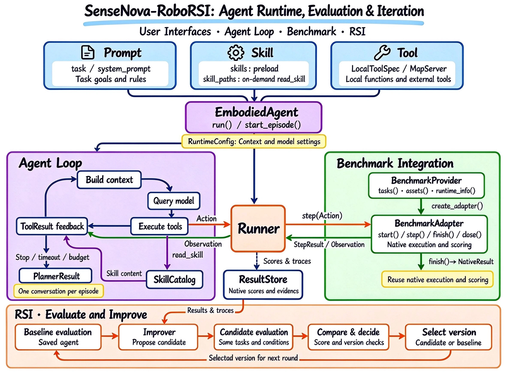
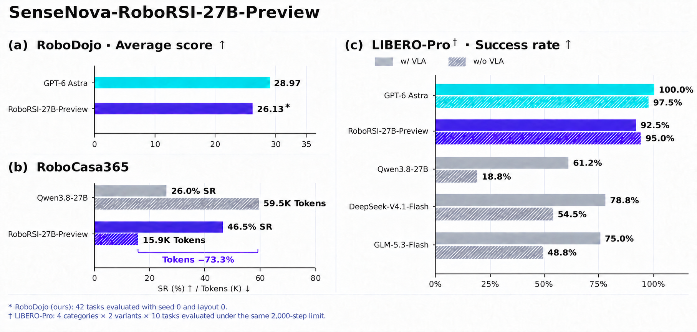

<h1 align="center">SenseNova-RoboRSI: Recursive Self-Improvement for Embodied Agents</h1>

<p align="center"><strong>Build, evaluate, and improve embodied agents with a shared runtime.</strong></p>

<p align="center">
  
  
  
</p>

<p align="center">
  <a href="https://www.sensenova.ai/has-gpt-6-astra-achieved-embodied-intelligence"></a>
  <a href="https://huggingface.co/sensenova/sensenova-roborsi-27b-preview"></a>
</p>

<p align="center">
  <strong>English</strong> · <a href="README.zh-CN.md">简体中文</a> ·
  <a href="#quick-start">Quick Start</a> · <a href="docs/README.md">Docs</a> ·
  <a href="https://www.sensenova.ai/has-gpt-6-astra-achieved-embodied-intelligence">Report</a> ·
  <a href="#benchzoo">BenchZoo</a> ·
  <a href="#harness-results">Harness Results</a> ·
  <a href="#sensenova-roborsi-27b-preview">RoboRSI-27B-Preview</a> ·
  <a href="#release-plan--roadmap">Release plan</a>
</p>

## News

- **2026-11-03** — Initial code and usage guides for [**LHPR-VLN**](benchmarks/lhpr_vln/README.md) and [**VLN-CE (R2R / RxR)**](benchmarks/vlnce/README.md) are available in this branch.

- **2026-10-30** — Initial code and usage guides for [**RoboLab**](benchmarks/robolab/README.md) are available in this branch.

- **2026-10-27** — Our LIBERO-PRO result (**98.25% success rate**) is now officially ranked **No. 1** on the [Papers With Code leaderboard](https://paperswithcode.co/benchmark/libero-pro).

- **2026-10-26** — SenseNova-RoboRSI is now ranked **No. 1** on the [RoboLab leaderboard](https://research.nvidia.com/labs/srl/projects/robolab/leaderboard.html).

- **2026-10-22** — **SenseNova-RoboRSI-27B-Preview** now runs across different environments, including on real robots and in simulation! [🤗 Model weights](https://huggingface.co/sensenova/sensenova-roborsi-27b-preview) and [usage guides](docs/sensenova-roborsi-27b-preview.md) are now available. The technical report is coming soon.

- **2026-10-22** — Initial code and usage guides for [**RoboCasa365 Target50**](benchmarks/robocasa365/README.md) are available in this branch.

- **2026-10-21** — Added **benchmark images and ICL experience packages** to [BenchZoo](#benchzoo), including image references and package download links.

- **2026-10-20** — Initial code and usage guides for [**BEHAVIOR-1K**](benchmarks/behavior_1k/README.md), [**Bench2Dex**](benchmarks/bench2dex/README.md) and [**DexJoCo**](benchmarks/dexjoco/README.md) are available in this branch.

- **2026-10-16** — Initial code and usage guides for [**LIBERO**](benchmarks/libero/README.md), [**LIBERO-PRO**](benchmarks/libero_pro/README.md), [**LIBERO-Long++**](benchmarks/libero_lilo/README.md) and [**LIBERO-Ultra-Long**](benchmarks/libero_lilo/README.md) are available in this branch. See the [getting started guide](docs/getting-started.md).

- **2026-10-16** — SenseNova-RoboRSI has been used in the empirical report [**Has GPT-6 Achieved Embodied Intelligence?**](https://www.sensenova.ai/has-gpt-6-astra-achieved-embodied-intelligence).

- **2026-10-09** — SenseNova-RoboRSI achieves an **average score of 60.08** and a **success rate of 54.17%** on RoboDojo, a gain of **+31.11 points** over the GPT-6 Astra baseline (**28.97**). Results are being submitted to the official RoboDojo leaderboard. See [Harness Results](#harness-results) for benchmark comparisons.

## Contributors

- **Project leads:** Hanming Deng, Zhongang Cai, Haiwen Diao, Zhi Hou, Zhonghua Wu, Qingyi Tao
- **Model team:** Silei Wu\*, Weiye Xu, Bo Liu, Pengfei Liu, Tailai Chen, Chenjing Ding, Jiahao Wang, Changxu Wei, Zongpu Zhang
- **Harness team:** Jiapeng Luo\*, Yuyao Shao, Linjun Dai, Ziyi Shang, Wanqi Yin, Xiaowan Li, Donghao Wu, Tianbo Zhong
- **Collaborators:** Quanzhou Li, Han Chong Chua, Ruisi Wang, Xiaoming Wu, Tianqi Liu, Jing Zuo, Hongcan Xiao, Qinyue Li
- **Advisor:** Dahua Lin, Xiaogang Wang, Ziwei Liu, Lewei Lu, Lei Yang

\* denotes team leads.

## Overview

Connect your model, skills, and robot tools through a shared runtime, customize
prompts and context, and evaluate policies in environments that retain their
native execution and scoring logic.

On top of this runtime, **recursive self-improvement (RSI)** uses execution
traces and task feedback to improve the Harness while keeping model parameters
fixed. Candidate changes are retested, and validated improvements are carried
into the next agent version, connecting task execution with continuous improvement.

🎉 **[SenseNova-RoboRSI-27B-Preview](#sensenova-roborsi-27b-preview)** extends this work to model training. Validated
interaction experience becomes multimodal supervision for goal understanding,
action decisions, and feedback-based correction. Updated models return to the
same runtime for evaluation and further exploration, connecting model training
and Harness improvement through shared experience and joint retesting.

<p align="center">
  
</p>

### Core capabilities

#### Harness: A shared runtime

- **Flexible agent interfaces.** Connect models, prompts, skills, and tools/MCP;
  configure context and caching to suit each task.
- **Unified execution and evaluation.** Run VLA skills, scripted actions, or
  end-effector tools across benchmarks with native feedback and scoring.
- **Experiment records and training data.** Record full traces, export training
  episodes, and run batch evaluations with concurrency and recovery.

#### RSI: Continuous Harness improvement

- **Learn from execution feedback.** Refine action prediction, planning,
  feedback, and memory organization while keeping model parameters fixed.
- **Retest and retain improvements.** Track agent versions, evaluate candidate
  changes under the same task conditions, and carry validated improvements forward.

## Quick Start

Use Python 3.10–3.12 for the Agent and evaluator. From the repository root:

```bash
python -m venv .venv
source .venv/bin/activate
python -m pip install -e '.[runtime,test]'
bench --help
```

On Windows, activate with `.venv\Scripts\Activate.ps1`.

Follow the [installation and first evaluation guide](docs/getting-started.md)
to prepare a benchmark and run a fixed-action or model Agent. Native benchmark
images target Linux; connecting to an existing HTTP benchmark requires no local
simulator installation.

- **Benchmark setup:** [LIBERO](benchmarks/libero/README.md),
  [LIBERO-PRO](benchmarks/libero_pro/README.md),
  [LIBERO-Long++ / LIBERO-Ultra-Long](benchmarks/libero_lilo/README.md),
  [Bench2Dex](benchmarks/bench2dex/README.md),
  [DexJoCo](benchmarks/dexjoco/README.md),
  [BEHAVIOR-1K](benchmarks/behavior_1k/README.md),
  [RoboCasa365](benchmarks/robocasa365/README.md),
  [RoboLab](benchmarks/robolab/README.md),
  [LHPR-VLN](benchmarks/lhpr_vln/README.md), and
  [VLN-CE (R2R / RxR)](benchmarks/vlnce/README.md).
- **Agent configuration:** [Models, prompts, context and budgets](docs/agents.md).
- **Evaluation:** [Batch execution, results and resume](docs/evaluation.md).

To deploy SenseNova-RoboRSI-27B-Preview, follow the
[model deployment instructions](docs/sensenova-roborsi-27b-preview.md#1-deploy-the-model).

### Evaluate a deployed model with one command

After installing the framework, connect a deployed model API that supports images
and tool calling. Use Linux/WSL with Docker ready; enhanced LIBERO and RoboCasa365
also require NVIDIA GPU support in Docker. Start with one RoboCasa task to check
the complete download, setup and evaluation workflow:

```bash
export OPENAI_BASE_URL='http://127.0.0.1:8000/v1'
export OPENAI_API_KEY='YOUR_API_KEY'
export MODEL_NAME='YOUR_SERVED_MODEL'
python scripts/evaluation/evaluate_model.py --benchmark robocasa365 \
  --task robocasa365:OpenDrawer --seed 1 --run-id robocasa-smoke-001
```

`--benchmark` is required: choose `libero`, `libero_pro`, `libero_long_plus_plus`,
`libero_ultra_long` or `robocasa365`; repeat it to select several. The script
downloads/builds the selected environment and prepares available ICL automatically.
Enhanced LIBERO uses the released `migration_subset` catalogs.

Configuration is centralized under [`configs/`](configs/README.md): each
`configs/benchmarks/<name>.yaml` selects its environment, model and Agent.
Edit [`configs/models/default.yaml`](configs/models/default.yaml) for the shared
model connection and optional `vla` model settings, and `configs/agents/` for Agent policies. The environment
variables above still override the model YAML; API keys stay in the environment.

Optional `--benchmark-config`, `--agent-config` and `--model-config` accept paths
(or `NAME=PATH` when selecting several benchmarks). Benchmark configs support
task/seed lists and [user Python selectors](configs/benchmarks/examples/select_first.py).
LIBERO Agents can opt into [automatic pi05 VLA download and deployment](docs/libero-vla.md)
with `parameters.enable_vla: true`; the simple `--benchmark NAME` entry remains.
Set `endpoint: http://host:18800` in a benchmark YAML to connect an existing
image's HTTP service; `endpoint: null` keeps automatic environment setup.
HTTP still prepares the selected Agent's ICL/tokenizer/VLA. Set benchmark
`token_env` for HTTP authentication and model `vla.endpoint` for an existing VLA.

Execution checks the main image/tool API and existing services before downloading.
Task/seed progress streams live; logs and a redacted configuration snapshot are
saved under the invocation's result directory. Plan offline or resume with a new ID:

```bash
python scripts/evaluation/evaluate_model.py --benchmark robocasa365 --dry-run
python scripts/evaluation/evaluate_model.py --benchmark robocasa365 \
  --run-id robocasa-retry --resume-from robocasa-001
```

The overview is `<results-root>/<run-id>/summary.json`; see the
[evaluation guide](docs/model-evaluation.md) for details.

After the smoke check, run all 340 RoboCasa cells without task/seed filters:

```bash
ROBORSI_ROBOCASA_CELLS=all python scripts/evaluation/evaluate_model.py \
  --benchmark robocasa365 --run-id robocasa-001
```

Select a standard LIBERO suite or the 50-cell RoboCasa seed-1 catalog through
environment variables:

```bash
ROBORSI_LIBERO_SUITE=libero_90 python scripts/evaluation/evaluate_model.py --benchmark libero
ROBORSI_ROBOCASA_CELLS=seed1 python scripts/evaluation/evaluate_model.py --benchmark robocasa365
```

Catalog defaults are configured in the benchmark YAML: `libero_spatial` for
`ROBORSI_LIBERO_SUITE`, `all` for `ROBORSI_ROBOCASA_CELLS`. Environment variables
override these defaults. Results are saved under `work/model_eval/results/`; use a new
`--run-id` for each run. To download/build without evaluation:

```bash
python scripts/evaluation/evaluate_model.py --benchmark robocasa365 --prepare-only
```

GPU/Docker requirements,
image access, task coverage, existing services and results are explained in the
[model evaluation guide](docs/model-evaluation.md). To deploy first, fill in the
reserved [model deployment entry point](scripts/deploy/README.md), then start the
API service before evaluation.

## BenchZoo

Available benchmark integrations and upcoming releases. Supported services share
configurable EmbodiedAgent presets; select your model and follow the corresponding
benchmark directory for setup and evaluation.

ICL experience packages are hosted in
[SenseNova-RoboRSI-Packages](https://huggingface.co/datasets/sensenova/SenseNova-RoboRSI-Packages).
The links below open each released benchmark's versioned package directory;
follow the package documentation for download, verification and usage.

Prebuilt images are hosted on GHCR. Use `docker pull <image>` with the
corresponding image reference from the table.

| Benchmark | Status | ICL experience package | Docker image |
| --- | --- | --- | --- |
| RoboDojo | Coming soon | — | — |
| [RoboCasa365](benchmarks/robocasa365/) | Released | [v1.0.0](https://huggingface.co/datasets/sensenova/SenseNova-RoboRSI-Packages/tree/main/robocasa365/v1.0.0) | `ghcr.io/opensensenova/sensenova-roborsi-robocasa365@sha256:28d210a42597f88c7af23b63f88fefc587edc901e268a0339cbfbf6ea1814cb5` |
| [LIBERO-Pro](benchmarks/libero_pro/) | Released | [v1.0.0](https://huggingface.co/datasets/sensenova/SenseNova-RoboRSI-Packages/tree/main/libero-pro/v1.0.0) | `ghcr.io/opensensenova/sensenova-roborsi-libero-pro@sha256:a83417f1459a4c555c457caa82ef00a5de50191e3d8deb943894fa9285cff172` |
| [LIBERO-Long++](benchmarks/libero_lilo/) | Released | [v1.0.0](https://huggingface.co/datasets/sensenova/SenseNova-RoboRSI-Packages/tree/main/libero-long-plus-plus/v1.0.0) | `ghcr.io/opensensenova/sensenova-roborsi-libero-long-plus-plus@sha256:814139261e914b114cb89a359c6a39d4f409a556f79928e986b6ade3dfe7dc7a` |
| [LIBERO-Ultra-Long](benchmarks/libero_lilo/) | Released | [v1.0.0](https://huggingface.co/datasets/sensenova/SenseNova-RoboRSI-Packages/tree/main/libero-ultra-long/v1.0.0) | `ghcr.io/opensensenova/sensenova-roborsi-libero-ultra-long@sha256:814139261e914b114cb89a359c6a39d4f409a556f79928e986b6ade3dfe7dc7a` |
| [RoboLab](benchmarks/robolab/) | Released | — | `ghcr.io/opensensenova/sensenova-roborsi-robolab@sha256:519585576bb09c5fc4a09e6255e30d74189b86b0f8c526d3fe8d99c5031da04f` |
| [Bench2Dex](benchmarks/bench2dex/) | Released | [v1.0.0](https://huggingface.co/datasets/sensenova/SenseNova-RoboRSI-Packages/tree/main/bench2dex/v1.0.0) | `ghcr.io/opensensenova/sensenova-roborsi-bench2dex@sha256:edb0701c6ea3904c53a64820775336b998e6a3d0a9ac8b3b5be2caf824db3a1b` |
| [DexJoCo](benchmarks/dexjoco/) | Released | [v1.0.0](https://huggingface.co/datasets/sensenova/SenseNova-RoboRSI-Packages/tree/main/dexjoco/v1.0.0) | `ghcr.io/opensensenova/sensenova-roborsi-dexjoco@sha256:19fa30540e3956ae460efa0a4b473586637cb330d863ea65ba0fd6318c376d4d` |
| [LHPR-VLN](benchmarks/lhpr_vln/README.md) | Released | [v1.0.0](https://huggingface.co/datasets/sensenova/SenseNova-RoboRSI-Packages/tree/495b4e2a9a3652726f52dd6363f7e2c5a77c2b34/lhvln/v1.0.0) | `ghcr.io/opensensenova/sensenova-roborsi-lhvln@sha256:7d72dd910d5c9048ca6ec40ad158214497c3a9ac276641df1429314f2d7a3695` |
| [VLN-CE (R2R / RxR)](benchmarks/vlnce/README.md) | Released | [v1.0.0](https://huggingface.co/datasets/sensenova/SenseNova-RoboRSI-Packages/tree/495b4e2a9a3652726f52dd6363f7e2c5a77c2b34/vln-ce/v1.0.0) | `ghcr.io/opensensenova/sensenova-roborsi-vln-ce@sha256:f54607562ca465101d6e1091f97d776755c2b00517f1852643bd8e0161c0e787` |
| SIMPLE | Coming soon | — | — |
| [BEHAVIOR-1K](benchmarks/behavior_1k/) | Released | [v1.0.0](https://huggingface.co/datasets/sensenova/SenseNova-RoboRSI-Packages/tree/main/behavior/v1.0.0) | `ghcr.io/opensensenova/sensenova-roborsi-behavior-1k:v1.0.0-cu128` |

## Harness Results

Each table shows SenseNova-RoboRSI alongside selected reference results. Higher is better.

### [RoboDojo](https://robodojo-benchmark.com/)

On RoboDojo-Sim, SenseNova-RoboRSI achieves an **average score of 60.08** and a
**success rate of 54.17%**. Compared with the **GPT-6-Astra** baseline, this is a
gain of **31.11 score points** and **31.69 percentage points** in success rate.

**Leaderboard submission:** Our results are being submitted to the official RoboDojo leaderboard. The official results may vary slightly; we will update the results here once they are available.

| Method | Average score ↑ | Success rate ↑ |
| --- | ---: | ---: |
| SenseNova-RoboRSI / GPT-6 Astra (ours) | **60.08** | **54.17%** |
| EmbodiedEvo | 45.08 | 38.95% |
| VPP2 | 39.26 | 32.26% |
| PhysicalRSI | 36.27 | 31.38% |
| Awomo-0.5 | 35.34 | 29.64% |
| Simate-beta | 33.95 | 27.96% |
| GPT-6-Astra (baseline) | 28.97 | 22.48% |

Reference results: [RoboDojo simulation leaderboard](https://robodojo-benchmark.com/leaderboard)
(updated **2026-10-14**, accessed **2026-10-15**).

### [LIBERO-PRO](https://zxy-mllab.github.io/LIBERO-PRO-Webpage/)

| Method | Success rate ↑ |
| --- | ---: |
| SenseNova-RoboRSI / GPT-6 Astra (ours) | **94.50%** |
| RPent / GPT-6 Astra | 92.63% |
| RPent / Opus-4.7 | 82.40% |
| RPent / GPT-5.5 | 75.13% |
| RPent Flash Mode / Molmo2-8B | 72.63% |

The reference scores above, including GPT-6 Astra's 92.63%, are reported by [RPent](https://rpent.readthedocs.io/zh-cn/latest/rst_source/leaderboard/performance.html) on Task/Swap suites. The [official LIBERO-PRO leaderboard](https://github.com/Zxy-MLlab/LIBERO-PRO#-libero-pro-model-leaderboard) reports a different aggregate across five perturbation types.

### [RoboCasa365](https://robocasa.ai/)

| Method | Evaluation setting | Success rate ↑ |
| --- | --- | ---: |
| SenseNova-RoboRSI / GPT-6 Astra (ours) | Target kitchens + task memory | **64.60%** |
| Paimon-0 | Pretraining kitchens | 58.10% |
| Xiaomi-Robotics-1 | Pretraining kitchens | 57.40% |
| Phasor-m7 | Pretraining kitchens | 56.80% |
| ProWAM | Pretraining kitchens | 48.10% |

Reference results: [official RoboCasa leaderboard](https://robocasa.ai/leaderboard.html). SenseNova-RoboRSI uses the Target50 setting; the official entries use pretraining kitchens. These results provide context across different evaluation settings and do not establish a ranking under the same protocol.

## SenseNova-RoboRSI-27B-Preview

**SenseNova-RoboRSI-27B-Preview** is an open-weight **27B embodied VLM** that
extends RoboRSI from Harness improvement to model training. Through **joint
model–Harness RSI**, it learns from validated interaction experience, bringing
goal understanding, action decisions, and feedback-based correction into the
model itself.

The model supports **VLA-assisted execution and direct VLM control**, with
evaluations on RoboDojo, LIBERO-Pro, and RoboCasa365, and demonstrations in
simulation and on real robots. The open weights provide a starting point for
community deployment, reproduction, and continued training.



Model weights are available on [🤗 Hugging Face](https://huggingface.co/sensenova/sensenova-roborsi-27b-preview).
See the [model guide](docs/sensenova-roborsi-27b-preview.md) for detailed results, demos, and usage instructions.

## Release Plan & Roadmap

### Release plan

- [x] Project introduction
- [x] [Empirical Study](https://www.sensenova.ai/has-gpt-6-astra-achieved-embodied-intelligence)
- [x] Initial code release: Agent runtime and LIBERO-family evaluation
- [x] [Usage documentation](docs/README.md)
- [x] [SenseNova-RoboRSI-27B-Preview release](docs/sensenova-roborsi-27b-preview.md)
- [ ] Harness demo
- [ ] RoboRSI Technical Report

### Research roadmap

- **Experience retrieval.** We plan to organize successful strategies, failure
  cases, and execution traces into a searchable experience library.
- **Transfer across tasks and environments.** We will investigate whether tool
  combinations, planning strategies, and feedback mechanisms validated in one
  setting can provide useful starting points in another.
- **More robot platforms and real-world scenarios.** We aim to extend integration
  and evaluation to more robot embodiments and physical settings, and examine the
  reliability of feedback-driven improvement in those environments.
- **Joint model–Harness RSI.** Continue converting validated interaction
  experience into training supervision, retest model and system changes together,
  and measure capability and efficiency across improvement rounds.

## Community & Acknowledgements

We welcome collaboration with teams working on foundation models,
VLA policies, simulation platforms, and real robots.

- **Contributions:** We welcome new integrations, evaluation tasks,
  reproducible failure cases, and suggestions for Harness design. See the
  [contribution guide](CONTRIBUTING.md) for the current release scope and checks.
- **Questions & collaboration:** Open an
  [issue](https://github.com/OpenSenseNova/SenseNova-RoboRSI/issues)
  describing your platform, use case, and proposed contribution.
- **Release updates:** Watch the
  [SenseNova-RoboRSI repository](https://github.com/OpenSenseNova/SenseNova-RoboRSI).
- **Acknowledgements:** We thank
  [RoboDojo](https://robodojo-benchmark.com/),
  [LIBERO-PRO](https://zxy-mllab.github.io/LIBERO-PRO-Webpage/),
  [RoboCasa](https://robocasa.ai/),
  [RPent](https://rpent.readthedocs.io/zh-cn/latest/), and the broader open-source
  community supporting embodied-agent research.
- **Licenses:** External models, simulators, and datasets retain their respective
  licenses.

**This achievement reflects the joint team's continued exploration and close collaboration in embodied AI and agent systems. SenseNova-RoboRSI has been used in the published report [Has GPT-6 Achieved Embodied Intelligence?](https://www.sensenova.ai/has-gpt-6-astra-achieved-embodied-intelligence). We will continue to advance and validate these technologies.**

## Citation

If you use SenseNova-RoboRSI in your research, please cite the following paper:

~~~bibtex
@misc{sensenova2026gpt6astraachievedembodiedintelligence,
      title={Has GPT-6-Astra Achieved Embodied Intelligence?},
      author={SenseNova and Joint Research Team and Zhongang Cai and Ziang Cao and Tailai Chen and Han Chong Chua and Linjun Dai and Hanming Deng and Hokin Deng and Haiwen Diao and Chenjing Ding and Weichen Fan and Xiao Fu and Zerui Gong and Chenyang Gu and Zexin He and Zhi Hou and Bo Li and Qinyue Li and Quanzhou Li and Xiaowan Li and Zhichao Liao and Dahua Lin and Zilong Lin and Bo Liu and Chunxiao Liu and Pengfei Liu and Tianqi Liu and Ziwei Liu and Chen Change Loy and Lewei Lu and Jiapeng Luo and Yuexiao Ma and Liang Pan and Xingang Pan and Oscar Qian and Ziyi Shang and Yuyao Shao and Dawei Su and Dacheng Tao and Qingyi Tao and Quan Wang and Ruisi Wang and Xiaogang Wang and Ziyi Wang and Beichen Wen and Donghao Wu and Jiaxu Wu and Silei Wu and Xiaoming Wu and Zhonghua Wu and Hongcan Xiao and Weiye Xu and Atsushi Yamashita and Lei Yang and Zhe Yang and Baiqiao Yin and Wanqi Yin and Hanfei Zhao and Tianbo Zhong and Long Zhuo and Jing Zuo},
      year={2026},
      eprint={2610.22471},
      archivePrefix={arXiv},
      primaryClass={cs.RO},
      url={https://arxiv.org/abs/2610.22471},
}
~~~
