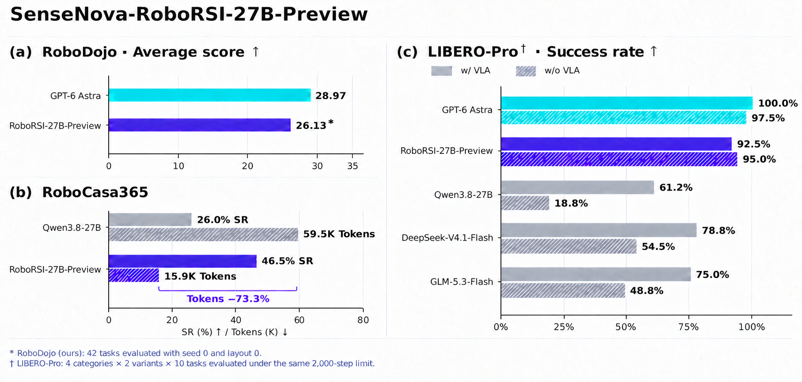
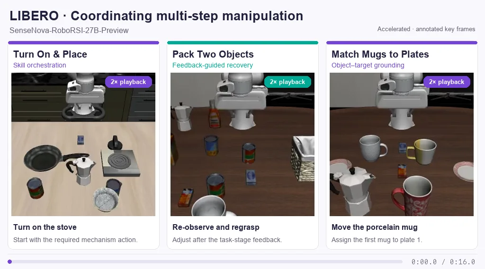
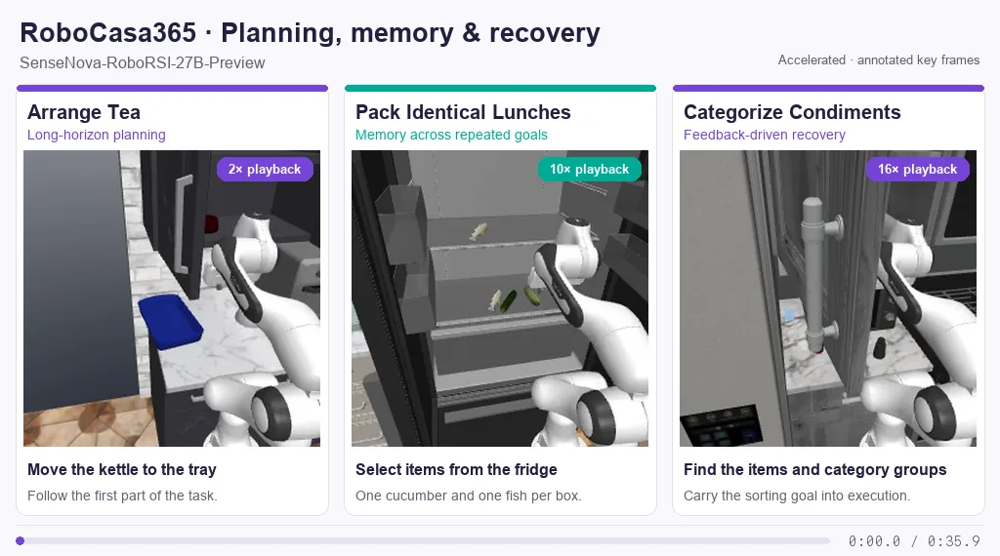

# SenseNova-RoboRSI-27B-Preview

[简体中文](sensenova-roborsi-27b-preview.zh-CN.md) · [🤗 Hugging Face](https://huggingface.co/sensenova/sensenova-roborsi-27b-preview) · [Demos](#demonstrations) · [Quickstart](#quickstart)

**SenseNova-RoboRSI-27B-Preview** is an open-weight **27B vision-language model
for embodied agents**. Through joint model–Harness RSI, it learns from validated
interaction experience, developing capabilities for planning, action decisions,
and feedback-based correction in simulation and on real robots.

The model weights are available on Hugging Face for community deployment,
reproduction, and continued training. This guide covers model deployment and
benchmark reproduction on **LIBERO-Pro and RoboCasa365** using **RoboRSI Harness**.
RoboDojo reproduction instructions will be released alongside upcoming RoboDojo
support in RoboRSI.



- **RoboDojo:** Achieves an **average score of 26.13** and a **task success rate of
  20.83%** with VLA-assisted execution. Its average score is just **2.84 points**
  below GPT-6 Astra's score in the RoboDojo team's evaluation. The model actively
  inspects visual details, reasons about spatial relationships, and corrects
  actions based on execution feedback during complex manipulation tasks.
- **LIBERO-Pro:** Reaches **92.5% success** with VLA-assisted execution
  (System 2 + System 1) and **95.0%** with direct VLM control (System 2), ranking
  second to GPT-6 Astra among the compared models in both settings. These results
  demonstrate embodied planning and decision-making across different execution
  architectures.
- **RoboCasa365:** RSI training raises success from **26.0% to 46.5%** over the
  Qwen3.8-27B base model, while reducing average output tokens from **59.5K to
  15.9K**, a **73.3% reduction**. Learning from interaction experience improves
  both task performance and inference efficiency.

## Demonstrations

**Real-robot demonstration**


**Simulation · RoboDojo**


**Simulation · LIBERO**



**Simulation · RoboCasa365**



## Quickstart

### 1. Deploy the model

#### Install vLLM

In your inference environment, install the CUDA 12.9 build with a compatible
NVIDIA driver:

```bash
pip install "vllm==0.21.0" huggingface_hub \
  --extra-index-url https://download.pytorch.org/whl/cu129
```

See the [vLLM installation guide](https://docs.vllm.ai/en/v0.21.0/getting_started/installation/gpu/) for other CUDA builds.

#### Download the model

Download the full checkpoint, including the tokenizer, processor, generation
configuration, and chat template:

```bash
export MODEL_DIR="$PWD/models/sensenova-roborsi-27b-preview"
hf download sensenova/sensenova-roborsi-27b-preview \
  --local-dir "$MODEL_DIR"
```

For an existing local checkpoint, set `MODEL_DIR` to its absolute path.

#### Start the service

```bash
export CUDA_VISIBLE_DEVICES=0,1,2,3

vllm serve "$MODEL_DIR" \
  --served-model-name sensenova-roborsi-27b-preview \
  --host 0.0.0.0 \
  --port 8000 \
  --dtype bfloat16 \
  --tensor-parallel-size 4 \
  --max-model-len 262144 \
  --generation-config auto \
  --chat-template "$MODEL_DIR/chat_template.jinja" \
  --reasoning-parser qwen3 \
  --enable-auto-tool-choice \
  --tool-call-parser qwen3_coder \
  --structured-outputs-config '{"backend":"xgrammar","disable_any_whitespace":true}' \
  --enable-prefix-caching \
  --mamba-cache-mode align
```

#### Check the endpoint

From another terminal on the same machine, check service health and send a
short robot-planning request:

```bash
curl --fail http://127.0.0.1:8000/health
curl --fail http://127.0.0.1:8000/v1/chat/completions \
  -H 'Content-Type: application/json' \
  -d '{
    "model": "sensenova-roborsi-27b-preview",
    "messages": [{
      "role": "user",
      "content": "A robot needs to place a mug on a coaster. Give a short plan and explain how to verify that the mug is stable before releasing it."
    }],
    "max_tokens": 8192,
    "chat_template_kwargs": {"reasoning_effort": "medium"},
    "stream": false
  }'
```

### 2. Connect RoboRSI Harness and run evaluations

Follow the existing [LIBERO-Pro](../benchmarks/libero_pro/README.md) and
[RoboCasa365](../benchmarks/robocasa365/README.md) evaluation guides to connect
your model to RoboRSI Harness and run evaluations.

One-command reproduction scripts for evaluating custom models are under
development and will be available soon.
