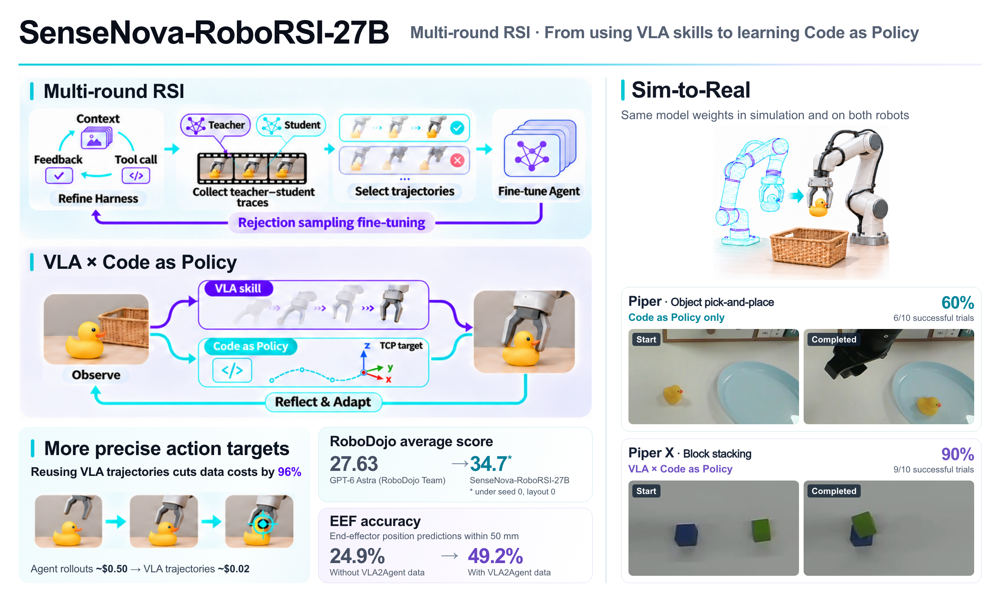
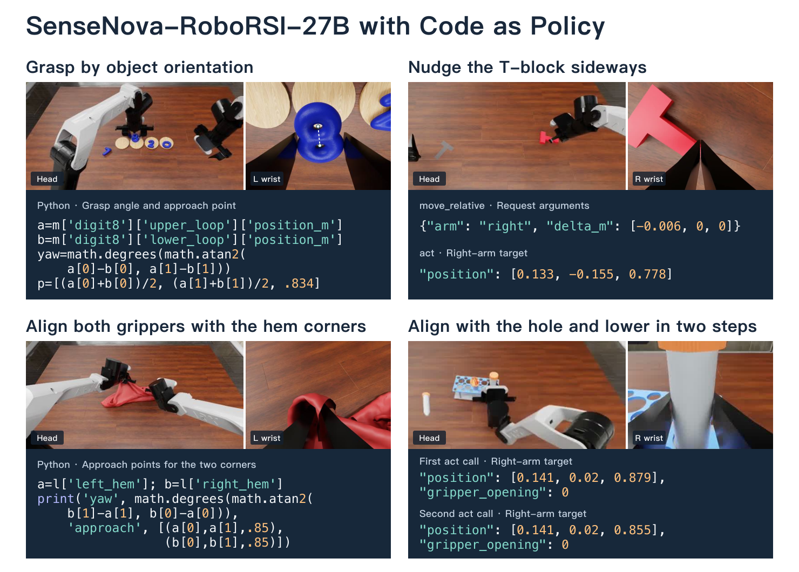
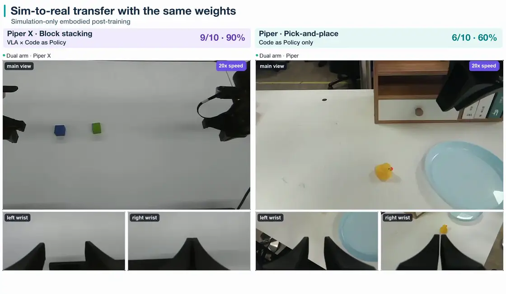

# SenseNova-RoboRSI-27B

[简体中文](sensenova-roborsi-27b.zh-CN.md) · [🤗 Hugging Face](https://huggingface.co/sensenova/SenseNova-RoboRSI-27B) · [Results & Demos](#results--demos) · [Quickstart](#quickstart)

SenseNova-RoboRSI-27B is a vision-language model for robot manipulation. It can request motion from a vision-language-action (VLA) policy, review a proposed trajectory, or write code to compute and execute a gripper target pose (Code as Policy). After each action, the agent uses new camera observations and robot state to decide what to do next.



*Figure 1. The same checkpoint runs in RoboDojo and on two physical robot platforms.*

## Results & Demos

### RoboDojo simulation

The GPT-6 Astra result comes from the RoboDojo Team’s published leaderboard. The release scores 7.1 points higher. We evaluated the other five entries at **seed 0, layout 0**, using the same general-purpose Harness with no task-specific skills. [RoboDojo Agent leaderboard](https://robodojo-benchmark.com/leaderboard#agent)


*Figure 2. Starting from a Preview score of 10.0, three rounds of updates reached 34.7 when both the model and Harness changed, 32.2 with model updates alone and 24.8 with Harness updates alone.*

We measured the distance in millimeters between the predicted and recorded gripper endpoint coordinates (x, y, z) on **374 local actions from 35 RoboDojo tasks**. Of these, 179 use one arm and 195 use both. A dual-arm prediction counts as a hit only when both arms meet the threshold. The median uses predictions with parseable coordinates.

VLA2Agent supplies end-effector target poses from open VLA demonstrations.

| Training configuration | Within 5 mm ↑ | Within 20 mm ↑ | Within 50 mm ↑ | Median XYZ error ↓ |
| --- | ---: | ---: | ---: | ---: |
| Without VLA2Agent | 4.3% | 9.4% | 24.9% | 119.7 mm |
| With VLA2Agent | **15.5%** | **29.7%** | **49.2%** | **51.6 mm** |


*Figure 3. Open-loop end-effector predictions, with and without VLA2Agent supervision and across reference models.*

The open-loop test measures how accurately the agent predicts a gripper target. In the RoboDojo trial below, the bowl is slightly left of the stack. The agent keeps its grip and uses Code as Policy to shift the target 2 cm to the right before lowering the bowl.


*Demo 1. Bowl stacking in simulation. Follow the three camera views and the control timeline as the agent chooses a VLA motion, checks the grasp and switches to code to correct a placement.*



*Figure 4. Code as Policy in simulation. The agent uses object orientation to plan a grasp, nudges a T-block sideways, aligns both grippers with garment corners, and inserts a test tube in two steps.*

### Physical robots (Piper & Piper X)

With **no real-robot data in embodied post-training**, SenseNova-RoboRSI-27B used the same checkpoint from simulation to pick and place objects on Piper and stack blocks on Piper X. We adapted only the camera, state and control interfaces to each platform. Each model ran ten trials per task.

| Platform | Task | Release execution mode | RoboRSI-27B | Preview | Qwen3.8-27B |
| --- | --- | --- | ---: | ---: | ---: |
| Piper | Object pick-and-place | Code as Policy only | **6/10 (60%)** | 2/10 | 0/10 |
| Piper X | Block stacking | VLA × Code as Policy | **9/10 (90%)** | 3/10 | 0/10 |



*Demo 2. Both robots use the same checkpoint. On the left, Piper X stacks blocks using VLA and Code as Policy. On the right, Piper places an object in a dish using Code as Policy alone.*

Two Piper trials show how the agent uses camera feedback to decide where to grasp and when to try again after a missed placement.


*Figure 5. Two Piper trials. In the first, the right wrist camera locates the target for a left-arm grasp. In the second, the block lands in front of the dish. The agent locates it again, picks it up and places it inside.*

## Quickstart

Download the checkpoint with the Hugging Face CLI. The release includes the model weights, tokenizer, visual processor and chat template. [🤗 Model Weights](https://huggingface.co/sensenova/SenseNova-RoboRSI-27B/tree/52ac9fdd07cbad42fab74217e595db12b4f1a000)

```bash
hf download sensenova/SenseNova-RoboRSI-27B --local-dir ./SenseNova-RoboRSI-27B
```

To connect your model endpoint to the Harness and run benchmarks, follow the [evaluation guide for deployed models](./model-evaluation.md).

**RoboDojo reproduction.** We will release the reproduction script after we submit our results to the RoboDojo leaderboard.

## License

SenseNova-RoboRSI-27B is released under the Apache License 2.0.
