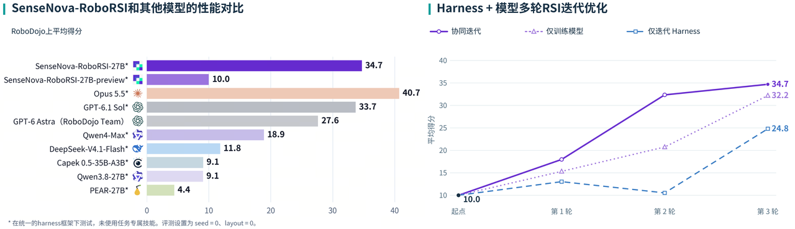
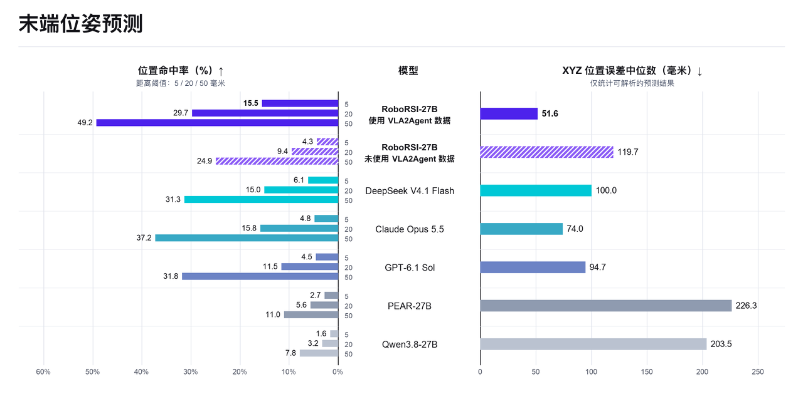
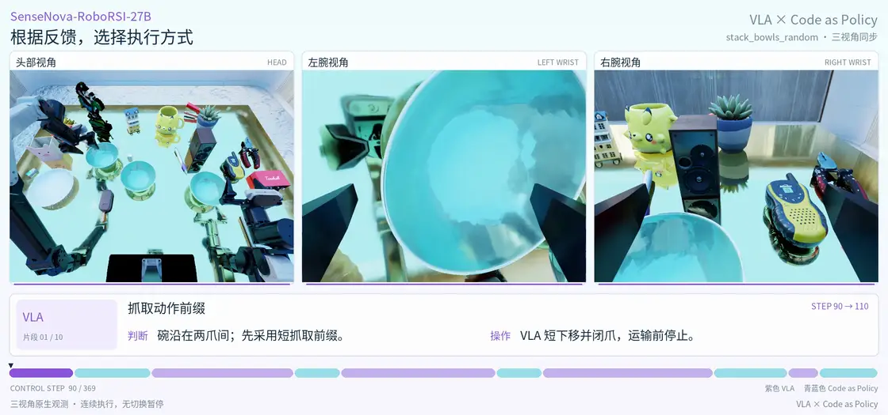
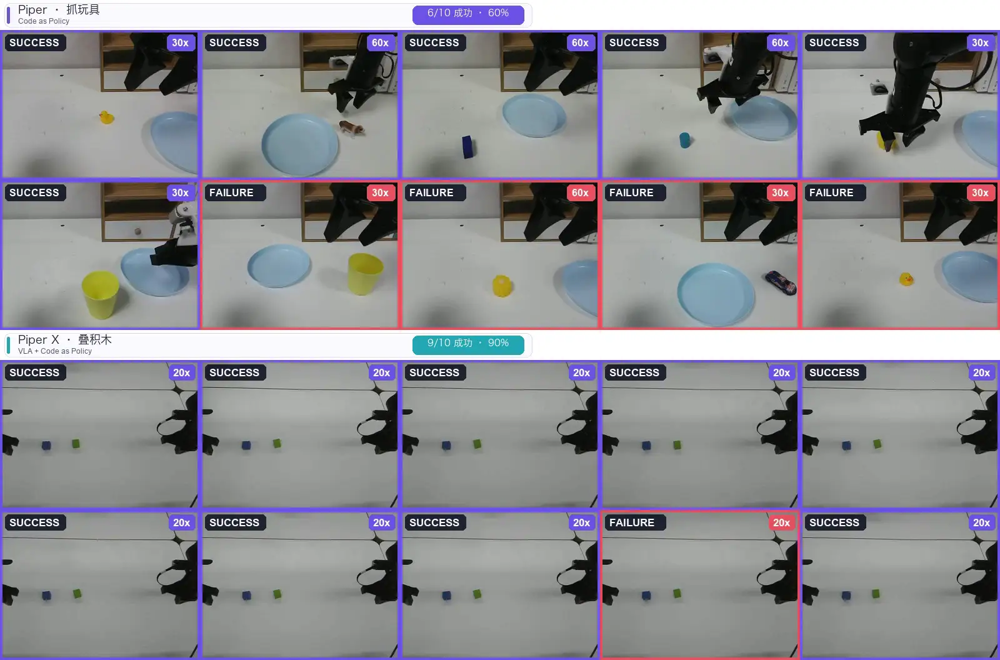
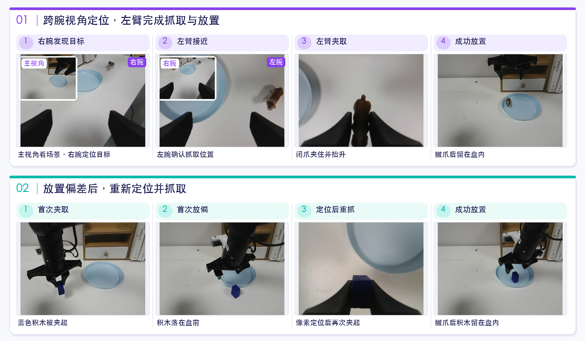

# SenseNova-RoboRSI-27B

[English](sensenova-roborsi-27b.md) · [🤗 Hugging Face](https://huggingface.co/sensenova/SenseNova-RoboRSI-27B) · [评测与演示](#评测与演示) · [快速开始](#快速开始)

SenseNova-RoboRSI-27B 是一款面向机器人操作的视觉语言模型。模型可以调用视觉语言动作策略（VLA）并审查候选轨迹，也可以编写代码计算夹爪的目标位姿，交给控制器执行（Code as Policy）。每次执行后，模型根据新的相机画面和机器人状态决定下一步动作。


*图 1　同一份模型权重用于 RoboDojo 仿真评测和两款真实机械臂。*

## 评测与演示

### RoboDojo 仿真

GPT-6 Astra 采用 RoboDojo Team 公布的榜单成绩，正式版比该参考高 7.1 分。其余五项均在 **seed 0、layout 0** 下使用同一套通用 Harness 测试，未配置任务专属技能。[RoboDojo Agent 排行榜](https://robodojo-benchmark.com/leaderboard#agent)



*图 2　从 Preview 的 10.0 分出发，三轮后，模型与 Harness 同时迭代达到 34.7 分，仅更新模型为 32.2 分，仅更新 Harness 为 24.8 分。*

评测包含 **来自全部 RoboDojo 任务的 374 条局部动作**，其中单臂 179 条、双臂 195 条。逐条比较预测的夹爪终点坐标 (x, y, z) 与轨迹记录的终点坐标，位置误差以毫米计。双臂动作须两只手臂都落入误差阈值才计为命中。位置误差中位数按坐标可解析的预测统计。

VLA2Agent 从开源 VLA 操作示范中提取末端目标位姿，作为动作监督。

| 训练配置 | 误差 ≤ 5 mm ↑ | 误差 ≤ 20 mm ↑ | 误差 ≤ 50 mm ↑ | XYZ 误差中位数 ↓ |
| --- | ---: | ---: | ---: | ---: |
| 未加入 VLA2Agent | 4.3% | 9.4% | 24.9% | 119.7 mm |
| 加入 VLA2Agent | **15.5%** | **29.7%** | **49.2%** | **51.6 mm** |



*图 3　开环末端位置预测。图中对比加入和未加入 VLA2Agent 监督的模型，并列出其他模型的参考结果。*

上面的开环评测衡量夹爪目标位置的预测误差。在下面的 RoboDojo 叠碗任务中，Agent 发现手里的碗比下方的碗偏左，于是保持夹爪闭合，用 Code as Policy 将目标位置向右调整 2 厘米，再放下碗。



*演示 1　仿真叠碗。对照三个相机视角和控制时间线，可以看到 Agent 如何选择 VLA 动作、检查抓取，并切换到代码控制来修正放置位置。*


*图 4　Code as Policy 仿真示例。Agent 按物体朝向抓取、侧推 T 形块、用双臂对准衣摆两角，以及分两步将试管插入孔位。*

### 真机（Piper 与 Piper X）

SenseNova-RoboRSI-27B 在**具身后训练中未使用任何真机数据**，直接用仿真评测的同一份权重在 Piper 上抓放物体、在 Piper X 上堆叠积木。我们仅适配了各平台的相机观测、机器人状态和控制接口。每个模型在每项任务上测试 10 次。

| 平台 | 任务 | 正式版执行方式 | RoboRSI-27B | Preview | Qwen3.8-27B |
| --- | --- | --- | ---: | ---: | ---: |
| Piper | 物体抓放 | 仅 Code as Policy | **6/10（60%）** | 2/10 | 0/10 |
| Piper X | 堆叠积木 | VLA × Code as Policy | **9/10（90%）** | 3/10 | 0/10 |



*演示 2　同一份模型权重在两款真机上的表现。左侧 Piper X 结合 VLA 和 Code as Policy 堆叠积木，右侧 Piper 仅用 Code as Policy 将物体放入盘中。*

Piper 的两段实测轨迹展示了 Agent 如何根据相机画面确定抓取位置，以及在积木落到盘外后如何重新抓取。



*图 5　两段 Piper 实测轨迹。上排用右腕相机定位、左臂抓放。下排中，积木落在盘前，Agent 再次定位并抓起积木，将其放回盘内。*

## 快速开始

使用 Hugging Face CLI 下载模型。发布文件包含模型权重、分词器、视觉处理器和对话模板。[🤗 模型权重](https://huggingface.co/sensenova/SenseNova-RoboRSI-27B/tree/52ac9fdd07cbad42fab74217e595db12b4f1a000)

```bash
hf download sensenova/SenseNova-RoboRSI-27B --local-dir ./SenseNova-RoboRSI-27B
```

要将已部署的模型服务接入 Harness 并运行评测，请参阅[已部署模型评测指南](./model-evaluation.zh-CN.md)。

**RoboDojo 复现脚本**将在我们向 RoboDojo 排行榜提交评测结果后发布。

## 许可证

SenseNova-RoboRSI-27B 采用 Apache License 2.0。
