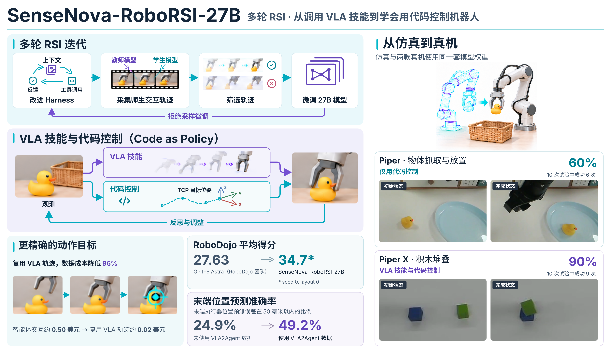
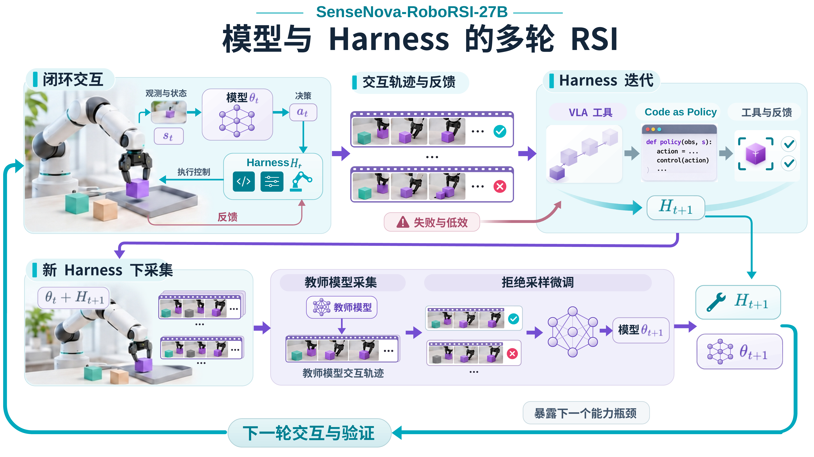
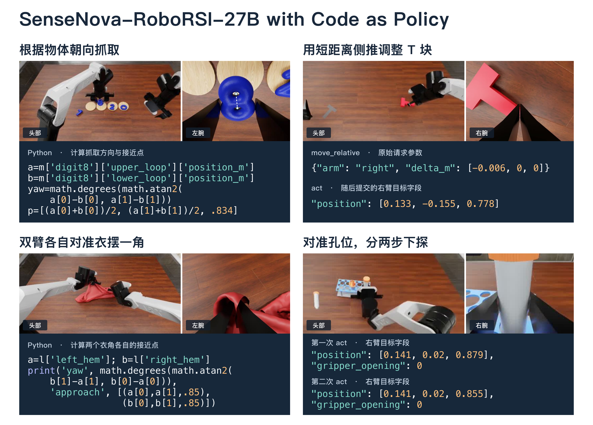
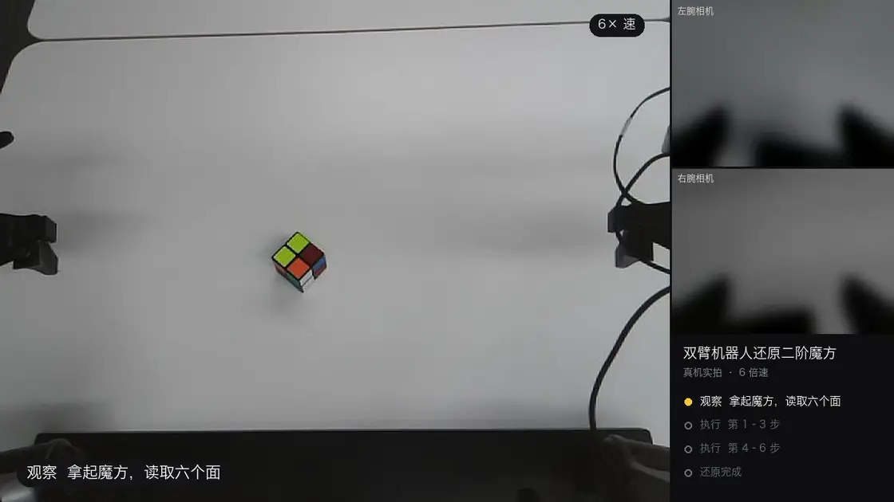

# SenseNova-RoboRSI-27B

[English](sensenova-roborsi-27b.md) · [🤗 Hugging Face](https://huggingface.co/sensenova/SenseNova-RoboRSI-27B) · [评测与演示](#评测与演示) · [快速开始](#快速开始)

SenseNova-RoboRSI-27B 是一款面向机器人操作的视觉语言模型。模型可以调用视觉语言动作策略（VLA）并审查候选轨迹，也可以编写代码计算夹爪的目标位姿，交给控制器执行（Code as Policy）。每次执行后，模型根据新的相机画面和机器人状态决定下一步动作。



*图 1　同一份模型权重用于 RoboDojo 仿真评测和两款真实机械臂。*

## 评测与演示

### RoboDojo 仿真

在 RoboDojo 上，SenseNova-RoboRSI-27B 的平均得分从 Preview 的 **10.0 分**升至正式版的 **34.7 分**。图中七个模型均使用同一套通用 Harness 评测，未配置任务专属技能。


*图 2　左图中，星号标出我们在 seed 0、layout 0 下的评测结果，GPT-6 Astra 的 27.6 分取自 [RoboDojo 官方榜单](https://robodojo-benchmark.com/leaderboard#agent)。右图对比三轮 RSI 的结果，每一轮都是模型与 Harness 协同迭代得分最高。*



*图 3　每一轮先用失败或低效的操作找出 Harness 需要改进的环节，再用教师模型在新 Harness 下采集轨迹。筛选后的轨迹用于微调 27B 模型，下一轮再验证两者的改进。*

评测包含 **来自全部 RoboDojo 任务的 374 条局部动作**，其中单臂 179 条、双臂 195 条。逐条比较预测的夹爪终点坐标 (x, y, z) 与轨迹记录的终点坐标，位置误差以毫米计。双臂动作须两只手臂都落入误差阈值才计为命中。位置误差中位数按坐标可解析的预测统计。

VLA2Agent 从开源 VLA 操作示范中提取末端目标位姿，作为动作监督。

| 训练配置 | 误差 ≤ 5 mm ↑ | 误差 ≤ 20 mm ↑ | 误差 ≤ 50 mm ↑ | XYZ 误差中位数 ↓ |
| --- | ---: | ---: | ---: | ---: |
| 未加入 VLA2Agent | 4.3% | 9.4% | 24.9% | 119.7 mm |
| 加入 VLA2Agent | **15.5%** | **29.7%** | **49.2%** | **51.6 mm** |


*图 4　开环末端位置预测。图中对比加入和未加入 VLA2Agent 监督的模型，并列出其他模型的参考结果。*

上面的开环评测衡量夹爪目标位置的预测误差。在下面的 RoboDojo 叠碗任务中，Agent 发现手里的碗比下方的碗偏左，于是保持夹爪闭合，用 Code as Policy 将目标位置向右调整 2 厘米，再放下碗。


*演示 1　仿真叠碗。对照三个相机视角和控制时间线，可以看到 Agent 如何选择 VLA 动作、检查抓取，并切换到代码控制来修正放置位置。*



*图 5　Code as Policy 仿真示例。Agent 按物体朝向抓取、侧推 T 形块、用双臂对准衣摆两角，以及分两步将试管插入孔位。*

### 真机（Piper 与 Piper X）

SenseNova-RoboRSI-27B 在**具身后训练中未使用任何真机数据**，直接用仿真评测的同一份权重在 Piper 上抓放物体、在 Piper X 上堆叠积木。我们仅适配了各平台的相机观测、机器人状态和控制接口。每个模型在每项任务上测试 10 次。

| 平台 | 任务 | 正式版执行方式 | RoboRSI-27B | Preview | Qwen3.8-27B |
| --- | --- | --- | ---: | ---: | ---: |
| Piper | 物体抓放 | 仅 Code as Policy | **6/10（60%）** | 2/10 | 0/10 |
| Piper X | 堆叠积木 | VLA × Code as Policy | **9/10（90%）** | 3/10 | 0/10 |


*演示 2　同一份模型权重在两款真机上的表现。左侧 Piper X 结合 VLA 和 Code as Policy 堆叠积木，右侧 Piper 仅用 Code as Policy 将物体放入盘中。*



*演示 3　两只机械臂翻转二阶魔方，观察六个面，再用六步将魔方还原。画面以 6 倍速播放。*

Piper 的两段实测轨迹展示了 Agent 如何根据相机画面确定抓取位置，以及在积木落到盘外后如何重新抓取。


*图 6　两段 Piper 实测轨迹。上排用右腕相机定位、左臂抓放。下排中，积木落在盘前，Agent 再次定位并抓起积木，将其放回盘内。*

## 快速开始

### 安装 vLLM

以下示例在 Linux x86_64 上使用四张支持 BF16 的 NVIDIA GPU。请在推理环境中安装 vLLM 0.21.0 的 CUDA 12.9 版本，并确保驱动与该版本兼容。其他 CUDA 版本见 [vLLM 安装指南](https://docs.vllm.ai/en/v0.21.0/getting_started/installation/gpu/)。

```bash
python -m pip install 'vllm==0.21.0+cu129' huggingface_hub \
  --extra-index-url https://wheels.vllm.ai/0.21.0/cu129 \
  --extra-index-url https://download.pytorch.org/whl/cu129
```

### 下载模型

下载正式版的权重、分词器、视觉处理器和对话模板。访问私有仓库时，先用有权限的账号运行 `hf auth login`。如果已有完整的本地模型，可将 `MODEL_DIR` 设为其绝对路径，直接启动服务。[🤗 模型权重](https://huggingface.co/sensenova/SenseNova-RoboRSI-27B/tree/52ac9fdd07cbad42fab74217e595db12b4f1a000)

```bash
export MODEL_DIR="$PWD/SenseNova-RoboRSI-27B"
hf download sensenova/SenseNova-RoboRSI-27B \
  --local-dir "$MODEL_DIR" --exclude 'assets/*'
```

### 启动服务

在四张 GPU 上以张量并行方式启动模型。服务使用模型自带的对话模板，并启用推理和工具调用解析。

```bash
export CUDA_VISIBLE_DEVICES=0,1,2,3

vllm serve "$MODEL_DIR" \
  --served-model-name sensenova-roborsi-27b \
  --host 0.0.0.0 \
  --port 8000 \
  --dtype bfloat16 \
  --tensor-parallel-size 4 \
  --max-model-len 262144 \
  --generation-config auto \
  --chat-template "$MODEL_DIR/chat_template.jinja" \
  --reasoning-parser qwen3 \
  --enable-auto-tool-choice \
  --tool-call-parser qwen3_coder \
  --structured-outputs-config '{"backend":"xgrammar","disable_any_whitespace":true}' \
  --enable-prefix-caching \
  --mamba-cache-mode align
```

### 验证接口

在同一台机器上打开另一个终端，检查服务状态，再发送一条机器人规划请求。服务就绪后，健康检查会返回 HTTP 200，模型回复位于 `choices[0].message`。

```bash
curl --fail http://127.0.0.1:8000/health
curl --fail http://127.0.0.1:8000/v1/chat/completions \
  -H 'Content-Type: application/json' \
  -d '{
    "model": "sensenova-roborsi-27b",
    "messages": [{
      "role": "user",
      "content": "A robot needs to place a mug on a coaster. Give a short plan and explain how to verify that the mug is stable before releasing it."
    }],
    "max_tokens": 8192,
    "chat_template_kwargs": {"reasoning_effort": "medium"},
    "stream": false
  }'
```

在运行 Harness 的终端中设置以下环境变量，然后按照[已部署模型评测指南](./model-evaluation.zh-CN.md)运行评测。

```bash
export OPENAI_BASE_URL='http://127.0.0.1:8000/v1'
export OPENAI_API_KEY='EMPTY'
export MODEL_NAME='sensenova-roborsi-27b'
```

**RoboDojo 复现脚本**将在我们向 RoboDojo 排行榜提交评测结果后发布。

## 许可证

SenseNova-RoboRSI-27B 采用 Apache License 2.0。
